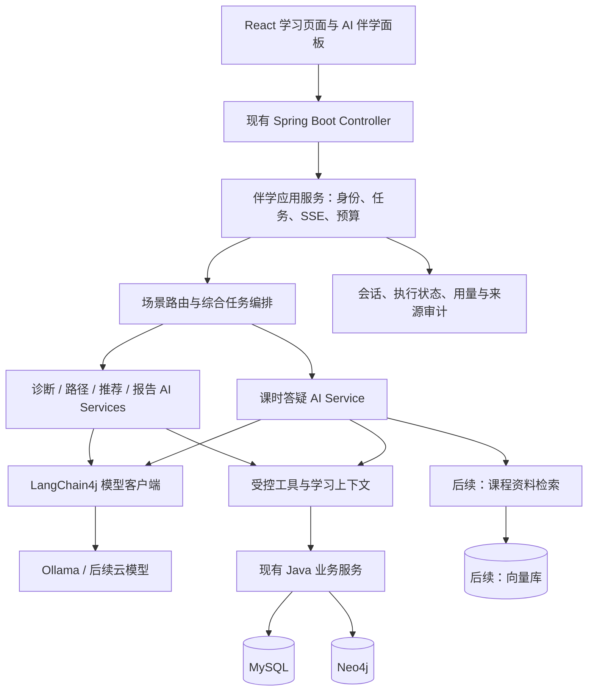

# 知度课堂 AI 伴学 LangChain4j 实施方案

编制日期：2026-09-15

方案状态：待实施；本文完成架构与实施设计，不代表已接入 LangChain4j 或通过运行验收。

适用范围：现有 React 前端、Spring Boot 后端、MySQL、Neo4j 与 Ollama 构成的知度课堂项目。

配套实施文档：[文档入口与当前状态](langchain4j/README.md)。阶段进度、P0 验证、接口约定与验收记录在配套文档中持续维护。

## 一、方案结论

采用 **Java 后端内嵌 LangChain4j** 的方式建设 AI 伴学：由 LangChain4j 处理模型交互、AI Service、工具调用与后续 RAG；由平台业务代码管理身份、课程访问、学习数据、任务预算、结果校验和持久化。

第一阶段采用 **LangChain4j 核心库手动装配 + 现有 Spring Boot 2.7.18 的兼容性验证**。兼容验证通过后逐项迁移；若发现不可接受的依赖冲突，则先单独完成 Spring Boot 升级，再接入官方 Starter。Java 17 满足 LangChain4j 当前核心库最低要求，但并不能据此认定所有依赖与 Boot 2.7 均兼容。[官方入门文档](https://docs.langchain4j.dev/get-started/) · [Spring Boot 集成文档](https://docs.langchain4j.dev/tutorials/spring-boot-integration/)

目标形成两条产品能力线：

1. **课时 AI 答疑**：在当前课程与课时上下文中进行多轮、流式辅导，并提供有效来源。
2. **四类学习 Agent**：学习诊断、学习路径、资源推荐、学习报告；后续通过统一编排形成综合学习规划。

优先完成一个可验证的诊断 Agent，再迁移其他能力。首期复用现有 Ollama 模型配置，不额外部署 Python 服务；四类 Agent 可以共用同一个模型，它们的差异由任务、工具范围和输出结构定义。

## 二、项目现状与迁移依据

以下为本次读取工作区代码得到的静态结论，包含工作区尚未提交的修改；数据库实际状态、模型可用性和部署效果需在实施阶段检查。既有阶段报告可作背景，发生差异时以代码与运行验证为准。

| 项目部分 | 当前代码情况 | 迁移处理 |
|---|---|---|
| 技术基线 | Java 17、Spring Boot 2.7.18 | 先验证核心库依赖，不直接添加最新版 Boot Starter |
| 模型接入 | `AiModelProvider` 接口、`OllamaProvider` 实现 | 引入 LangChain4j 适配实现，保留旧实现作为灰度回退路径 |
| 课时答疑 | `AiTutorApplicationService` 管理 SSE、取消、会话、审计 | 先维持外部协议，再替换内部模型交互 |
| 四类入口 | `/api/agents/guide`、`path`、`recommend`、`analysis` | 保留现有入口和返回兼容层 |
| Agent 执行 | `LearningAgentAiService` 手写工具循环，最多 4 轮、6 次工具调用 | 迁移到 AI Service 或框架低层 API，并保留预算与必要证据检查 |
| 工具 | `LearningAgentToolbox` 提供学习概况、薄弱点、候选资源、图谱先修查询 | 改造成限定范围的工具适配器，复用业务查询 |
| 学习上下文 | `AiLearningContextService` 校验课时访问并装载课时资料 | 保留权限入口，作为 RAG 与工具调用的上下文基础 |
| 图谱 | `Neo4jLearningContextService` 查询先修关系 | 继续作为结构关系来源，明确区分层级关系与先修关系 |
| 路径保存 | `LearningPathParser` 校验解析，`StudentLearningPathService` 保存 MySQL 快照并同步 Neo4j | 保留课程 ID 校验、快照读取与同步重试 |
| 会话数据 | 初始化代码定义 `ai_conversation`、`ai_message`、`ai_message_citation` 等表 | 保留用户可见历史，不直接套用框架消息格式覆盖旧表 |
| 使用记录 | `ai_usage_log`、`agent_logs` | 增加执行引擎、步骤和版本信息，统一请求关联 |

当前默认模型配置为 `qwen3:8b-q4_K_M`。这是配置值，不是本次重新完成的模型选型；工具调用、JSON 输出、流式和实际资源占用均需实测。

特别说明：当前学习诊断中的“薄弱知识点”主要来自学习记录及进度规则。**播放进度、学习完成度不能直接表述为知识掌握率或考试成绩。** 后续只有接入真实练习与测评数据后，才能扩展掌握度评估。

## 三、建设目标与范围

### 3.1 用户能够获得的能力

- 在学习页面围绕当前课时提问，获得解释、举例、提示和下一步学习建议。
- 根据本人真实学习记录得到诊断，并看到依据与数据不足之处。
- 根据目标、已知先修关系和可访问课程生成可执行的学习路径。
- 获得限定在平台有效候选范围内的资源推荐，并说明推荐原因。
- 生成包含统计时间窗、事实摘要和改进建议的学习报告，继续支持现有报告下载。
- 在后续综合规划中获得一致的诊断、路径、推荐与报告，不重复采集相互矛盾的数据。

### 3.2 分期范围

| 首期必须交付 | 后续增强 |
|---|---|
| 核心库兼容验证、单 Agent 试点、旧新引擎切换 | 自动 Supervisor、多模型路由 |
| 四入口迁移、输出校验、审计、流式回归 | 课程资料向量检索与重排 |
| 本人数据隔离、课时权限、任务总预算 | Redis 分布式限流、跨实例取消 |
| MySQL 历史与图谱业务能力复用 | 长期画像、计划采用与版本管理 |
| 可复现验收样例与回退验证 | MCP 对外工具服务、外部工具集成 |

文档向量检索、Redis 和 MCP 均按阶段引入。它们不是运行首个 LangChain4j Agent 的前置条件。

## 四、总体架构



### 4.1 职责划分

- **Controller**：复用登录验证、参数检查和现有 URL，不把模型 SDK 类型暴露给前端。
- **应用服务**：创建服务端请求 ID，绑定登录用户、课程范围、取消信号和总预算；控制持久化和终态。
- **场景编排**：根据明确入口选择 Agent；综合任务采用固定依赖关系。
- **AI Service**：提供场景提示词、工具调用和输出解析。LangChain4j 的 AI Services 支持工具、记忆和 RAG，可作为服务层组件使用。[AI Services 文档](https://docs.langchain4j.dev/tutorials/ai-services/)
- **工具与业务服务**：验证参数、权限、候选资源与来源，执行固定业务操作。
- **模型适配层**：集中设置模型地址、超时、请求选项、Token 统计和取消行为。

### 4.2 建议代码组织

下列目录为设计建议，均放在现有 `com.learning.platform.ai` 包下；实施时先复用已有类，避免重复抽象。

```text
ai/
├── application/             # 现有应用入口、预算、路由与状态管理
├── langchain4j/
│   ├── config/              # 手动创建模型与 AI Service Bean
│   ├── agent/               # 五个场景接口与组装逻辑
│   ├── tool/                # LearningAgentToolbox 的受控适配
│   ├── memory/              # 会话窗口或运行时消息存储适配
│   └── provider/            # 兼容现有模型接口的过渡实现
├── domain/                  # 请求上下文、结构化结果、证据与预算
├── context/                 # 学习上下文、图谱查询与治理
├── memory/                  # 现有用户可见会话仓储
└── rag/                     # 后续：文档索引、检索与引用校验
```

## 五、Agent 设计与协作方式

### 5.1 场景定义

| 场景 / 建议接口名 | 输入 | 允许使用的主要工具 | 输出与结束条件 |
|---|---|---|---|
| 课时答疑 `TutorAssistant` | 当前课时、问题、有限历史 | 当前课时资料、相关知识点；后续资料检索 | 流式回答与有效引用；无证据时说明范围 |
| 学习诊断 `DiagnosisAgent` | 本人学习快照、统计时间窗 | 学习概况、薄弱点 | 事实摘要、问题依据、下一步行动；必须取得学习概况 |
| 路径规划 `PathAgent` | 学习目标、诊断结果、候选课程 | 概况、资源、先修关系 | 1–5 步学习路径；课程 ID 合法、顺序经业务校验 |
| 资源推荐 `RecommendationAgent` | 目标或路径、候选资源 | 候选资源、必要的薄弱点 | 候选范围内的资源 ID、用途与原因；无候选时返回空列表 |
| 学习报告 `ReportAgent` | 同一快照的诊断、路径、推荐 | 单独执行时按需取概况和资源 | 带时间窗的报告结构，由现有模板生成下载文件 |

四张卡片是四类任务入口；课时答疑是独立会话能力。四个接口的存在本身不代表已经实现多 Agent 协同。

### 5.2 综合学习规划

拟增加综合入口，执行顺序为：

```text
读取一次学习快照、时间窗和资源版本
  → 学习诊断
  → 路径规划 + 先修关系校验
  → 为有效路径步骤匹配资源
  → 汇总为学习报告
```

- `snapshotId`、`requestId`、时间窗与证据在整个任务内共享，避免各 Agent 重复查询不同版本的数据。
- 只调用完成当前任务所需的 Agent。单独点击“推荐”不强制执行其他三项。
- 下游使用经校验的结构化结果，不将上游自然语言当作可信指令。
- 路径失败时可保留已完成的诊断，报告明确标记未完成部分；重试失败步骤时验证快照和依赖版本是否仍有效。
- 每个子任务有局部预算，综合任务还必须有共享总预算，不能无限叠加四份额度。

首版编排由普通 Java 服务控制。LangChain4j 的 `langchain4j-agentic` 提供工作流与 Supervisor 能力，但官方仍将其列为实验性模块；后续仅在与固定流程对照评估后考虑引入。[Agentic 文档](https://docs.langchain4j.dev/tutorials/agents/)

## 六、工具、证据与输出校验

### 6.1 工具目录

| 工具名 | 数据来源 | 关键规则 |
|---|---|---|
| `get_learning_profile` | 本人学习记录快照 | 学生 ID 来自服务端登录上下文 |
| `get_weak_knowledge` | 学习记录及既有统计规则 | 返回指标定义，不把低进度等同于能力不足 |
| `get_learning_resources` | 已审核、有效且当前用户可访问的资源 | 返回本次候选 ID 集合及版本 |
| `get_graph_prerequisites` | Neo4j 已治理先修关系 | 限制主题长度、深度、节点数；返回可用性与来源 |
| `get_current_lesson_materials`（拟新增） | 当前课时已授权资料 | 复用播放器访问检查，限制资料大小 |
| `search_course_materials`（后续） | 课程向量索引 | 检索前限定课程权限，检索后再校验资源状态 |

工具可以通过 `@Tool` 或显式工具注册接入 LangChain4j，业务查询仍调用现有 Java 服务。[工具调用文档](https://docs.langchain4j.dev/tutorials/tools/)

每次执行使用不可变的服务端上下文，至少包含 `userId`、可访问范围、`requestId`、截止时间和取消信号。该上下文不得作为模型可修改的参数；不能在单例工具对象上存放可变的“当前学生”。异步回调必须显式传递上下文，不能假定请求线程身份会自动传播。

工具只执行固定查询，不接受任意 SQL、Cypher、脚本或文件路径。资料正文与工具结果均按不可信内容处理。调用每个工具前检查场景白名单、参数、权限及剩余预算。

### 6.2 输出契约

保持现有 `LearningAgentResult` 返回兼容性，在内部逐步引入独立结果类型：

- `DiagnosisResult`：时间窗、统计事实、观察、证据 ID、行动建议、数据缺口。
- `PathResult`：路径标题、目标、步骤、完成标准、候选课程 ID、先修校验状态。
- `RecommendationResult`：资源 ID、适用步骤、推荐理由、证据 ID。
- `ReportResult`：统计区间、摘要、诊断、路径、推荐、限制说明。

建议统一附带 `schemaVersion`、`snapshotId` 和 `warnings`。`requestId`、模型信息、实际工具列表、引用列表、图谱使用标志、耗时和 Token 用量由服务端执行记录产生，不能相信模型自行填写的值。

校验顺序：

1. JSON / Java 类型解析及字段长度、数量限制。
2. 场景必要工具或等价预取证据是否齐全。
3. 课程 ID 是否属于本次候选集合，是否仍可访问。
4. 引用 ID 是否存在于本次实际取得的证据集合。
5. 路径是否违反已知先修关系，是否存在重复、成环或缺少依赖。
6. 校验通过后保存并返回；修复最多尝试一次，且计入原任务预算。

结构化输出能力与模型、版本有关，不能只靠提示词保证。引用存在不等于支持结论：程序验证引用身份和权限，评测集与人工抽检进一步验证引用是否支持对应陈述。

### 6.3 学习路径与图谱

MySQL 保存个人路径快照作为可靠读取来源，Neo4j 保存图关系投影；同步失败时返回明确状态并允许重试。个人建议顺序不能自动写成公共先修知识。

现有路径生成接口会保存快照。首期保留这一行为；如新增“采用计划”，应把“生成建议”和“学生采用”建模为不同状态，并新增采用记录、版本与幂等约束。不能把旧快照直接推断为用户已采用。

## 七、会话记忆与课程 RAG

### 7.1 会话与长期画像

框架的 Chat Memory 是提供给模型的上下文窗口，用户可见的完整聊天历史由现有 MySQL 仓储管理；二者生命周期不同。[Chat Memory 文档](https://docs.langchain4j.dev/tutorials/chat-memory/)

首期建议由现有应用服务读取已完成历史、生成有界上下文，每次调用独立组装 AI Service 或模型请求，避免同时开启两套记忆导致历史重复。四类分析任务默认基于快照无状态执行。

后续确需框架持久化记忆时：

- 记忆键按服务端验证后的 `userId + conversationId + scene` 生成；相同会话写入串行化。
- 当前 `ai_message.role` 仅包含 `USER / ASSISTANT / SYSTEM_SUMMARY`，不能直接保存工具调用消息。拟增独立运行时记忆存储，或在每次任务内保留工具消息而不跨任务持久化。
- 消息窗口裁剪必须保持工具调用与工具结果成对，预留系统提示、检索证据和输出预算。
- 已取消、失败和未完成内容不得被当作成功回答回灌。
- 删除会话时同时清除或禁用对应框架记忆、摘要与缓存；旧请求的迟到回调不得恢复已删除会话。
- 长期目标、每周投入时间等画像由明确的用户输入和业务规则维护；模型推测只能作为待确认建议，且可更正。

Redis 初期不是必需组件；多实例部署或明确的缓存需求出现时再增加，MySQL 继续保存业务事实与历史。

### 7.2 RAG 建设路径

RAG 指回答前检索相关资料，再把资料作为上下文提供给模型。LangChain4j 提供检索增强相关组件。[RAG 文档](https://docs.langchain4j.dev/tutorials/rag/)

当前课时资料装载不等于已经具备向量知识库。后续按以下过程建设：

```text
已审核课时资料
  → 提取正文与来源位置
  → 按章节、段落切块
  → 生成 Embedding
  → 写入向量索引
  → 按授权范围检索并核验来源
  → 提供给答疑 Agent
```

- 初期只索引已有 `content_text` 等可追溯正文；扫描件 OCR、音视频转写另立任务，不能把标题当作完整课程知识。
- 向量库建议先评估独立 Qdrant，保持现有 MySQL 与 Neo4j 职责；以权限过滤、更新删除、部署资源和召回效果验证后定案。
- 每个片段至少记录课程公开 ID、内部课程 ID、课时 ID、资料 ID、内容版本、片段 ID、来源位置、审核状态和 Embedding 版本。
- 当前公开 `courseId` 对应资源 ID，内部 `courses.id` 是另一种标识；索引与接口必须明确映射，避免关联错误。
- 资料修改按内容哈希与版本重建；下架或撤权立即阻止检索使用，后台补做向量删除。
- Embedding 模型版本与维度必须随索引固定；更换模型时重建索引，不能混用不同空间。
- 返回少量相关片段并控制总 Token；召回不足时说明没有找到依据。
- Neo4j 负责先修结构，向量库负责文本相似检索；相似内容不能被解释为先修关系。

## 八、接口兼容与流式生命周期

### 8.1 保留的接口

| 接口 | 迁移要求 |
|---|---|
| `POST /api/ai/tutor/chat/stream` | 保留请求字段 `conversationId/courseId/lessonId/message/mode` 与 SSE |
| `POST /api/ai/requests/{requestId}/cancel` | 仅请求所属学生可取消；终态幂等 |
| `GET /api/ai/conversations`、`GET/DELETE /api/ai/conversations/{id}` | 保留列表、历史、删除与用户隔离 |
| `POST /api/ai/messages/{id}/feedback` | 保留评分和反馈关联 |
| `POST /api/agents/{guide,path,recommend,analysis}` | 保留四类入口；内部迁移，兼容原响应 |
| `/api/agents/reports` 及报告下载、删除接口 | 继续验证报告归属和文件路径 |
| `GET /api/learning/paths/latest`、`GET /api/learning/paths/{pathId}`、`POST /api/learning/paths/{pathId}/sync` | 保留路径快照读取和同步重试 |

综合规划入口作为后续新增契约单独设计，不能直接改变现有四卡片接口语义。

### 8.2 SSE 与取消

现有事件名称保持兼容：`conversation.created`、`message.started`、`message.delta`、`citation.added`、`message.completed`、`error`。适配 LangChain4j 流式回调时沿用这些事件；框架提供流式响应能力，但底层取消方式需对选定客户端与版本实测。[流式文档](https://docs.langchain4j.dev/tutorials/response-streaming/)

- 成功内容、来源和用量持久化成功后，才发送 `message.completed`。
- 取消、超时、浏览器断开和模型错误争用同一个终态控制，迟到结果不能覆盖失败或取消状态。
- 关闭 SSE 与 `Future.cancel(true)` 不能单独证明模型请求已终止；验证底层网络关闭或客户端取消，并确保并发许可仅在请求确实退出后释放。
- 若候选客户端不能满足取消要求，该流式场景暂保留旧适配器，不能以停止显示文字代替取消验收。
- 流式内容已发出后不自动重试整段生成，防止重复文本；重试规则仅适用于尚无对外输出且安全可重试的阶段。
- `citation.added` 只发送校验后的来源；普通回答允许逐字显示，路径、课程链接和结构化结论在校验后展示。
- SSE 一旦开始传输，错误通过约定的 `error` 事件表达，不能再假定可以修改 HTTP 状态码。

### 8.3 预算与降级

现有默认并发 1、排队 5、用户每分钟 10 次、SSE 超时 150 秒可作为首轮对照基线，并不代表已通过负载验收。四类任务现有 4 轮、6 次工具调用限制需要配置化，并明确“模型调用轮次”和“工具执行次数”分别计数。

新增统一截止时间覆盖排队、检索、工具、模型、修复与编排。单次模型超时不得超过剩余任务时间；只读查询可以有限重试，写入必须具备幂等机制。模型重试同样消耗调用与 Token 预算。

图谱不可用时保留基于学习记录的建议并标明“先修关系未校验”；无候选资源时返回空推荐；模型不可用时返回明确失败，不能把固定模板伪装成模型分析。跨模型降级仅对预配置并验证过的模型启用，必须记录实际模型。

## 九、数据、审计与部署

### 9.1 数据演进

首个单 Agent 试点尽量复用旧表；新增能力以独立迁移脚本实现，不把业务升级仅寄托于启动时 `create table if not exists`。

| 数据位置 | 拟议演进 |
|---|---|
| `agent_logs` | 增加执行引擎、Schema 版本、快照 ID、总用量等必要字段 |
| `ai_usage_log` | 保留请求关联；无法取得的用量标记 unknown，避免把缺失值解释为真实 0 |
| `ai_message_citation` | RAG 阶段扩展文档片段来源；当前枚举不能直接写入 `DOCUMENT_CHUNK` |
| `student_learning_paths` | 后续增加草稿/采用关系、版本及请求幂等；当前只有快照和同步状态 |
| `ai_agent_step`（拟新增） | 保存父请求、步骤序号、Agent/工具名、状态、耗时、错误、版本、输入输出摘要 |
| 运行时记忆与索引任务记录（按需新增） | 区分模型消息、用户历史及索引状态，避免一个表承担所有职责 |

现有 `ai_conversation` 与 `ai_usage_log` 的课程、课时字段非空。综合规划若不依附课时，应使用独立任务记录或显式迁移，不使用虚假的课程/课时 ID 填充。

新增字段应兼容旧代码；`partial` 等新增任务状态先在新任务/步骤记录表达，不直接写入旧枚举。迁移脚本需包含前置检查、索引、回填和回退说明。普通回退切回旧引擎并保留新增数据，不自动删除用户历史。

### 9.2 可观测性

以服务端 `requestId` 关联 API、Agent、工具、模型、持久化与报告。记录场景、版本、模型、首字延迟、总耗时、实际用量、工具次数、引用、校验结果和错误类型。

默认记录脱敏摘要，避免输出密钥、完整学生资料或模型内部推理。后续可接入 Langfuse 等平台；适配方式、数据字段和实际传输范围需要验证，不能假设引入 LangChain4j 后自动获得完整链路。

重点看板：成功率、超时率、取消后释放情况、无证据比例、非法引用拦截次数、工具失败分布、每场景模型调用次数和成本。

### 9.3 部署与引擎切换

- 首期保持单后端实例；复用 MySQL、现有 Neo4j 与 Ollama 部署。
- 建议增加项目自定义配置 `app.ai.engine=legacy|langchain4j`，并支持按场景选择执行引擎。该配置为拟新增项目约定，不是框架自带功能。
- 过渡期实现 `LangChain4jModelProvider` 适配现有接口，先验证模型层；迁移 AI Service 后在应用服务边界选择整套执行引擎，防止旧循环与框架循环重复执行工具。
- 密钥通过环境或部署密钥管理注入；模型名、超时、预算和提示词版本集中管理。
- 多实例阶段再增加请求归属、共享限流和取消路由；当前内存请求表不能跨实例取消。
- 发布后按场景灰度，同一个请求固定执行引擎；问题请求终止后新请求再回退，不对正在执行的业务写入做无条件重放。

## 十、实施计划与交付物

下表工期是单名熟悉项目的开发者的工作量估算，不是响应性能或交付日期承诺。P0 通过后再调整后续排期；课程资料清洗和图谱治理工作量另计。

| 阶段 | 预计工作日 | 实施内容 | 交付物 / 进入下一阶段的条件 |
|---|---:|---|---|
| P0 兼容与能力验证 | 1–2 | 锁定 Java、LangChain4j、HTTP/JSON 客户端版本；检查依赖树；验证 Ollama 对话、工具、JSON、流式、取消 | 依赖兼容矩阵、模型能力矩阵、运行记录；通过后锁定版本，失败则明确 Boot 升级范围 |
| P1 学习诊断试点 | 2–3 | 接入概况和薄弱点工具；独立上下文、结构化诊断、预算、审计、旧新引擎开关 | `/guide` 可灰度；权限、证据、故障及回退样例通过 |
| P2 四类入口迁移 | 3–5 | 接入路径、推荐、报告；保留课程校验、先修校验、快照保存与文件下载 | 四卡片结果可追溯；图谱不可用时正确降级；避免重复写入 |
| P3 流式答疑迁移 | 2–4 | 桥接 SSE、历史裁剪、引用、反馈、取消、终态与用量 | 前端无需感知引擎差异；断开和取消通过底层验证 |
| P4 课程 RAG | 3–5 | 索引代表性课时资料；版本、权限过滤、引用片段、下架处理 | 索引更新/删除验证；固定问答集的检索与依据质量达标 |
| P5 综合规划与发布 | 2–4 | 固定工作流、共享快照、步骤重试、总预算；完成压测和灰度 | 综合规划报告、故障演练、回退记录、运维说明 |

P0–P3 构成首期，估计 **8–14 个工作日**；全部阶段约 **13–23 个工作日**。若需升级 Spring Boot，需另计 `javax` 到 `jakarta`、依赖与完整业务回归的工作量，不能并入单 Agent 接入的原估算。

## 十一、验收标准

### 11.1 功能与隔离用例

| 验收场景 | 通过标准 |
|---|---|
| 首次学习、无记录 | 明确数据不足，不生成虚构成绩、完成记录或掌握率 |
| 诊断与推荐 | 能追溯到当前学生事实与有效候选；候选外资源全部拦截 |
| 课程 ID 混用 | 公开资源 ID 与内部课程 ID 映射正确，不能越权关联课时 |
| 先修图谱正常 / 空 / 不可用 / 成环 | 正常路径符合样例先修关系；其余状态明确降级或拒绝不合法路径 |
| 跨用户访问 | 历史、请求取消、反馈、路径和报告均不可跨用户读写 |
| 两名学生并发 | 工具上下文、记忆、来源与输出互不串用 |
| 同一会话并发 | 明确排队或拒绝，历史顺序与模型上下文一致 |
| 未知工具、非法参数、资料指令注入 | 受控终止或忽略越界指令；不执行未授权操作 |
| 模型超时、错误 JSON、重复工具 | 有界结束，不把失败结果保存成完成任务 |
| 取消、断网与迟到回调 | 后端请求退出、资源释放、终态不反转；前端不继续追加迟到文本 |
| 存储失败 | 不发送成功完成事件；审计显示失败，允许安全重试 |
| 路径重复提交 / 图谱同步失败 | 按契约去重，MySQL 快照可读，图谱同步可重试 |
| 资料下架、撤权、更新 | 旧索引不会绕过权限，引用能定位正确资料版本 |
| 切回旧引擎 | 历史、路径、报告仍可访问，无破坏性数据转换 |

### 11.2 质量与性能评估

- 建立至少 40 个带期望事实和允许来源的固定样例，覆盖课时答疑及四类入口，每类至少 8 个；权限、取消、故障用例另列。
- 旧新引擎使用相同数据、提示词目标、模型和参数对照，每例至少重复 3 次，保存结果与版本。
- 有确定规则的权限、ID、状态及路径约束用自动化测试覆盖；回答正确性、引用支持度和建议可执行性由人工评审，不只用模型自评分。
- 发布门槛建议：确定性隔离与业务校验用例全部通过；固定内容样例任务合格率至少 90%，且不低于旧引擎基线。阈值是目标，不是已测成绩。
- 分开记录模型冷启动与热启动的首字延迟、P50/P95 总耗时、成功率、Token 和调用次数。测试前写明 CPU/GPU、内存、模型版本、输入输出长度、并发与样本量。
- 首期用现有并发限制建立基线，观察队列、取消和超时；禁止在未压测前承诺秒级响应。新引擎热态 P95 若比基线恶化超过 20%，需解释原因并优化或暂缓扩大灰度。
- 取消验证同时检查应用连接、执行线程及许可释放；模型服务端是否立刻停止计算取决于服务能力，应单独记录，不能只依据前端停止输出判断。

### 11.3 最终交付清单

1. 锁定版本的依赖配置、兼容性说明及模型能力矩阵。
2. 课时答疑与四类 Agent 实现、工具目录、提示词版本和结果契约。
3. 接口兼容记录、数据迁移与回退脚本。
4. 场景引擎开关、超时/取消/限流配置及运维手册。
5. 固定评测集、关键测试结果、真实模型演示和性能基线。
6. 已知限制清单：未接入的资料、未治理的图谱关系、实验性模块及未通过能力。

## 十二、推荐实施起点

下一步以 **“LangChain4j 学习诊断 Agent 试点”** 为独立实施单元：完成 P0，接入本人学习概况与薄弱点工具，生成经校验的诊断结果，使用现有 `/api/agents/guide` 返回，并支持切回原实现。

这一步通过后，再依次扩展路径、推荐、报告及流式答疑。这样每个阶段都能在知度课堂页面中验证实际效果，并为后续 RAG 与综合学习规划留下清晰接口。
